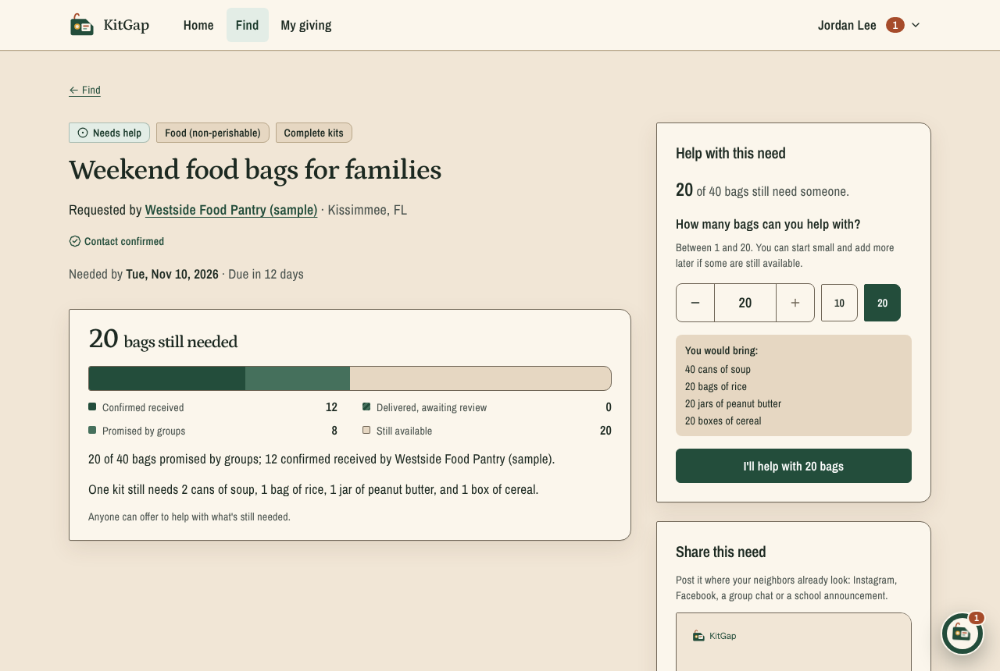

# KitGap

Food pantries, shelters, schools, senior homes and animal rescues post exactly what they need, like 40 weekend food bags with 2 cans of soup, a bag of rice, a jar of peanut butter and a box of cereal in each. Neighbors, families and school clubs pick a need, say how much they'll bring, collect it and drop it off. The place then confirms what actually arrived, and only that counts.

I built it for the 2026 Congressional App Challenge (FL-15). AI tools helped; [docs/ai-usage.md](docs/ai-usage.md) says how.

Live at https://kitgap.vercel.app, with a demo at [/demo](https://kitgap.vercel.app/demo) that gives you a private sample town to click around in.



## What it does

- **Find** open needs by category, with what's still needed and what's been confirmed.
- **Help** with part of a need, or **run your own drive** for a place that isn't on KitGap. Invite people, track pledges, record what came in, and pack kits.
- **Confirm.** The organization accepts all or part of each drop-off. For your own drive, the place confirms through a one-time receipt link, no account needed.
- **Share** a need as a square image with a QR code and a caption to paste.
- Organizations are checked by a person before their needs go public. Public pages never show who pledged or where to drop off.

Extras: Kit, a helper that answers questions about a need (AI, with a fallback to written rules), a photo counter that runs in the browser, and a "Found online" tab for drives posted on other sites. It also installs as an app on phones.

## Running it

```bash
npm install
npm run db:start            # local Supabase in Docker
cp .env.example .env.local  # fill it in, see docs/setup.md
npm run db:migrate
npm run dev                 # http://localhost:3000
```

Checks:

```bash
npm run check      # typecheck, lint, unit and integration tests
npm run test:e2e   # browser tests (needs the app and local Supabase running)
```

Integration tests need a Postgres database in `DATABASE_URL`. Each test file creates its own schema and drops it afterwards.

## Docs

- [setup.md](docs/setup.md): environment variables, deploying to Supabase and Vercel
- [quantity-model.md](docs/quantity-model.md): how every number is worked out
- [architecture.md](docs/architecture.md): code layout, permissions, the demo sandbox
- [mobile.md](docs/mobile.md): the installable app and the iOS/Android projects
- [limitations.md](docs/limitations.md): what's missing or untested

## Stack

Next.js 16, React 19, TypeScript, Tailwind CSS 4, Supabase (auth) and Postgres through postgres.js, Vitest and Playwright.
