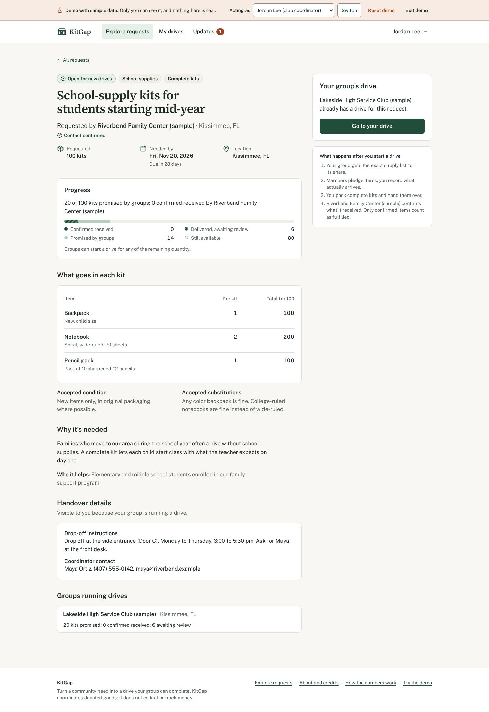

# KitGap

**Help your community get exactly what it needs.**

Local places such as food pantries, shelters, schools, senior homes and animal rescues post exactly what they need, for example 40 weekend food bags with 2 cans of soup, a bag of rice, a jar of peanut butter and a box of cereal in each. Neighbors, families and school clubs find a need, say how much they'll help with, collect it and drop it off. The organization confirms what actually arrived, and only that counts.

Built for the 2026 Congressional App Challenge. See [docs/ai-usage.md](docs/ai-usage.md) for how AI was used.



## What works

- **Find:** every open need near you, with big category icons (food, school, seniors, pets, hygiene, winter, babies), search and filters. A "Found online" tab lists drives posted elsewhere, so there's always something to help with.
- **A need's page** shows exactly what to bring, how much is still needed, and a progress bar where only what the organization confirmed counts as done.
- **Share kit:** a ready-made square post image with a QR code, a caption to copy, and buttons for the phone's share sheet (Instagram, WhatsApp and more), Facebook and email. A view counter shows how far a need has travelled, without storing anything about visitors.
- **Organizations:** register, post needs in a four-step form (drafts saved, a preview of each kit, duplicate checks), review what was handed over (accept all, or part with a reason), close, reopen, cancel, post updates and invite staff.
- **Helpers and groups:** offer to help with part of a need, invite others, record what arrives, pack kits, report the handover, and fix or replace anything not accepted.
- **Kit, the helper:** a button in the bottom right of every page. Kit greets you with what needs you (deliveries to review, deadlines, needs nobody has seen), refreshes every minute, answers questions by text or voice, and replies with buttons to the right page. On a need you run, Kit explains why help is slow and writes Instagram posts (one tap opens the share sheet with the picture) and emails to likely partners. AI-assisted (an OpenAI-compatible model, with whisper and kokoro for voice), with a guardrail: every number Kit writes must come from the need's real data, and written rules answer when the AI can't.
- **Two kinds of confirmation:** *Verified* means a reviewed organization member confirmed the handover in KitGap. *Recipient* means someone at the receiving place signed a one-time receipt link, for drives you run yourself.
- **KitGap reviewers** confirm each organization's contact before its needs go public.
- **Installable app:** works from the home screen on phones (PWA), with native iOS and Android projects ready in `ios/` and `android/` (see [docs/mobile.md](docs/mobile.md)).
- **Try the demo:** a private sample town for each visitor, with a food pantry, a senior home, an animal rescue and a school, sample people to switch between, a step-by-step guide and a reset.

## Run it locally

```bash
npm install
npm run db:start       # local Supabase in Docker
cp .env.example .env.local   # then fill it in, see docs/setup.md
npm run db:migrate
npm run dev            # http://localhost:3000, demo at /demo
```

Full instructions, including deployment to Supabase and Vercel, are in [docs/setup.md](docs/setup.md).

## Checks

```bash
npm run typecheck && npm run lint && npm test   # 85 unit and 56 integration tests
npm run test:e2e                                # browser and accessibility tests
```

## Documentation

| Document | Contents |
| --- | --- |
| [docs/setup.md](docs/setup.md) | Local setup, environment variables, deployment, auth and email settings |
| [docs/quantity-model.md](docs/quantity-model.md) | How every number is calculated, the invariants, concurrency and retries |
| [docs/architecture.md](docs/architecture.md) | Requests and drives, code map, permissions, what's public, the demo sandbox, code to know |
| [docs/testing.md](docs/testing.md) | Test results and how each acceptance test is covered |
| [docs/accessibility.md](docs/accessibility.md) | What was checked and what still needs manual testing |
| [docs/research.md](docs/research.md) | UX research note and the design decisions it informed |
| [docs/user-testing.md](docs/user-testing.md) | Task sheet for testing with real people |
| [docs/limitations.md](docs/limitations.md) | What doesn't exist or hasn't been verified |
| [docs/cac-demo.md](docs/cac-demo.md) | Demo video outline, judge questions and submission checklist |
| [docs/mobile.md](docs/mobile.md) | Installable app, native projects and store checklist |
| [docs/repurpose-plan.md](docs/repurpose-plan.md) | Why KitGap became a community needs board, and what changed |
| [docs/ai-usage.md](docs/ai-usage.md) | AI usage and credits (to be completed by the student) |
| [docs/screenshots/](docs/screenshots/) | Screenshots of the main screens |

## Stack

Next.js 16 (App Router) and React 19, TypeScript, Tailwind CSS 4, Supabase Auth and Postgres (accessed from the server with postgres.js), Vitest, Playwright and axe-core.
